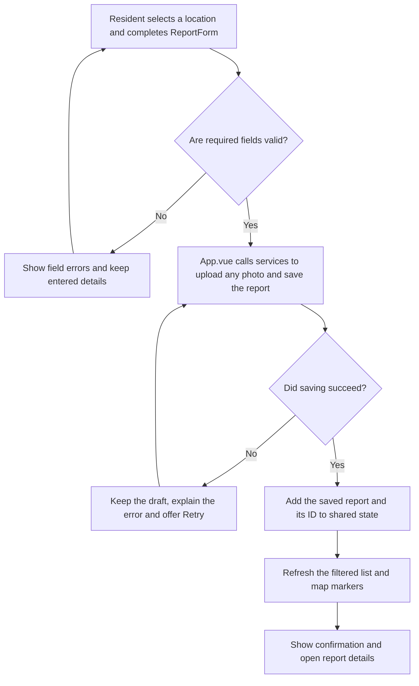

# Assembly Connect

A community reporting tool that lets residents in Ghana put neighborhood problems on a map, contribute evidence, and follow what happens next.

**Project stage:** Proposal and initial wireframes. Assembly Connect is a working name, and the pilot assembly is still to be selected. The application has not been built yet.

## Project Proposal

1. **The specific participants/community I want to engage are...**

   Residents, market traders, and small business owners within one Ghanaian Metropolitan, Municipal or District Assembly who encounter problems such as blocked drains, uncollected waste, and damaged drain covers in their neighborhoods. I want to start with one assembly so the reporting categories and review process fit a specific place.

2. **The contributions/input I am inviting them to make are...**

   Reports with a map location, description, optional photo, and details about what they observed and when. Participants can also add observations to an existing report, indicate “This affects me too,” and provide an update when an issue changes or appears to have been fixed.

3. **The participants will benefit from contributing their input by...**

   Having a shared record of an issue they want addressed, seeing whether someone has already reported it, and following its progress without starting a new complaint each time. They can add evidence and show that a problem affects others in the neighborhood. The aim is to make reporting and follow-up easier; submitting a report does not guarantee a repair or an assembly response.

4. **The users that will use the collected data are...**

   Residents checking problems in their area, and designated assembly staff reviewing reports and coordinating a response. For the class project, a demonstration reviewer role will stand in for assembly staff. There is no confirmed assembly partnership yet.

5. **The collected data will benefit those users by...**

   Giving residents a view of reported problems and recorded updates. For assembly staff, the map, photos, and observations would help locate issues, identify repeated reports, assess their impact, assign the appropriate team, and keep a record of action taken.

## Overview

The app will have a public map and report list. Residents will be able to filter by category and status, open an issue, and contribute to it. Before creating a report, they will be encouraged to check nearby reports to avoid duplicating the same problem.

To report an issue, a resident will place a pin or use their device location, enter a landmark and description, and optionally attach a photo. They will answer simple questions about the impact they observed. For a blocked drain, this could mean whether water is overflowing onto a footpath or entering a property. They can review their details before submitting.

Each saved report will have a reference number and an update history. Other residents can select “This affects me too,” add evidence, and follow updates. Authorized reviewers will have a separate workspace to assign a team, assess priority, and record progress.

The proposed statuses are **Submitted, Acknowledged, In progress, Resolved**, and **Referred** when another body is responsible. Reported impact, community support, and reviewer-assigned priority will remain separate. A high support count will not automatically make an issue urgent.

The first version will focus on one assembly, a small set of reporting categories, and the complete report-and-review workflow. It will be a class prototype: reports will be saved to a demonstration system, not automatically sent to a government agency. Sample reports and reviewer updates will be labeled accordingly.

## Initial Wireframes

The wireframes cover desktop browsing, mobile reporting, submission and follow-up, and the assembly review workspace.

- [Open the wireframe gallery](docs/wireframes/index.html)
- [View the boards and interaction notes](docs/wireframes/README.md)

The gallery is a static preview. Its illustrated buttons and forms are not functioning app controls.

## Data & Citations

**Reference data:** The app will need a basemap and a boundary for the selected assembly. The municipality and data providers have not been selected yet, so no reference dataset is currently in use. Exact source links, licenses, and attribution will be added here and in the app when those choices are made.

**Participant-contributed data:** Planned report fields include a report ID, category, coordinates, address or landmark, description, optional photo, observation date, impact answers, and submission timestamp. Related records will store support, follow-up observations, team assignments, and status updates with their author and date. Contact details, if collected for accounts or updates, will be kept separate from public report content.

**Prototype data:** All locations, reports, names, and counts in the wireframes are illustrative. They are not evidence of actual complaints or assembly actions.

The [wireframe notes](docs/wireframes/README.md#design-references) include the design references used to shape the reporting and review process. These are design references, not sources of report data.

## Technical Details

Only the wireframes and documentation exist at this stage. The planned application needs:

- A responsive Vue.js frontend built with Vite, with a map and an equivalent report list.
- Shared persistent storage so reports and updates remain available after reloading and can be seen by other participants.
- Photo storage, with validation and access rules.
- Authentication and permissions separating resident contributions from reviewer actions.
- Form validation, submission feedback, and a way to retain entered details when saving fails.
- Keyboard-accessible controls, labeled fields, readable status indicators, and mobile layouts.

The mapping library, database, photo storage provider, and sign-in method are still to be chosen. The frontend is intended for GitHub Pages; shared reports and photos will need a separate storage service. No AI component is required for this project.

### Planned Vue components and data flow

This is the proposed structure, not implemented code. `App.vue` will coordinate the interface and initially hold shared state: reports, active filters, the selected report, the draft location, the signed-in user, and loading or error messages. Vite provides the development server and builds the frontend for deployment.

```mermaid
flowchart TD
    App["App.vue — shared state and coordination"]

    subgraph UI["Vue interface components"]
        Filters["ReportFilters.vue — category and status"]
        Map["ReportMap.vue — markers and location selection"]
        List["ReportList.vue — accessible report browsing"]
        Form["ReportForm.vue — details, photo and submission"]
        Details["ReportDetails.vue — evidence, support and updates"]
        Auth["AuthPanel.vue — sign in and sign out"]
        Review["ReviewerPanel.vue — assignment, priority and status"]
    end

    App -->|"props: current values and data"| Filters & Map & List & Form & Details & Auth & Review
    Filters -->|"event: change filters"| App
    Map -->|"event: select report or draft location"| App
    List -->|"event: select report"| App
    Form -->|"event: submit report"| App
    Details -->|"event: support, follow or add observation"| App
    Auth -->|"event: request sign in or sign out"| App
    Review -->|"event: submit reviewer update"| App

    subgraph Services["JavaScript service modules"]
        Reports["reports.js — read and save reports and contributions"]
        Photos["photos.js — upload and retrieve photos"]
        Accounts["auth.js — authentication and session changes"]
    end

    App <-->|"requests, results and errors"| Reports & Photos & Accounts

    subgraph Backend["Shared backend — provider to be selected"]
        DB[("Database — reports, support, follows and history")]
        Storage[("Photo storage")]
        Identity["Authentication service"]
    end

    Reports <-->|"authorized reads and writes"| DB
    Photos <-->|"authorized uploads and downloads"| Storage
    Accounts <-->|"user session"| Identity
```

**How the pieces communicate:** Props pass data from `App.vue` to its child components. Events let those components tell `App.vue` what the user did. Service modules handle backend communication so database calls do not get scattered across the interface. Backend access rules must enforce reviewer permissions; hiding the reviewer panel alone does not protect status updates.

For example, selecting a report in either the map or the list updates the same selected-report state. `App.vue` passes that selection to the details panel and the map. The map component then uses the mapping library to update its highlighted marker; Vue does not update map-library markers automatically.

### Report submission flow

**Build order:** Start with `App.vue`, `ReportMap.vue`, `ReportList.vue`, `ReportForm.vue`, and `reports.js`. Get one report saved and visible after reloading. Then add filters and report details, followed by authentication, photos, community contributions, and reviewer controls. Until backend permissions are implemented, use demonstration data only. The initial version does not need a separate state-management library or router.

### Preview the wireframes

Open `docs/wireframes/index.html` in a browser, or right-click that file in VS Code and choose **Open with Live Server**. SVG and PNG versions of each board are in the same directory.

Application setup and deployment instructions will be added once the app is implemented.
